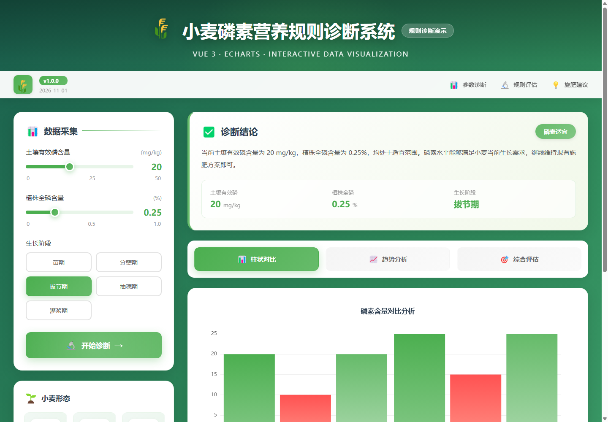
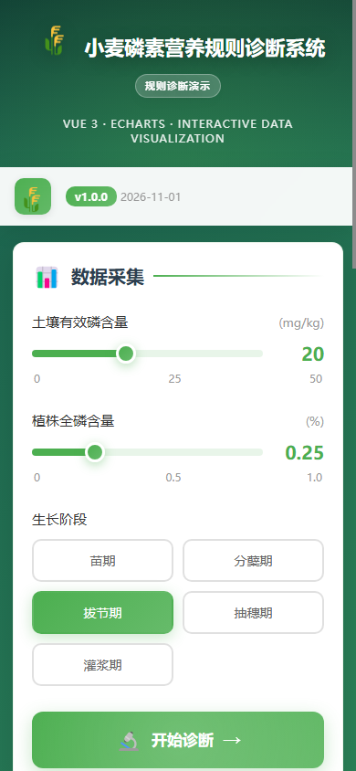

# 小麦磷素营养规则诊断系统

一个基于 Vue 3、Vite 和 ECharts 构建的农业数据可视化前端作品。项目通过可调参数、生长阶段和预设阈值规则，演示小麦磷素营养诊断与施肥建议的完整交互流程。

> 本项目是规则驱动的教学演示，不包含机器学习或真实田块传感器数据。

## 页面预览





## 在线演示

- GitHub Pages：<https://vyu-yu.github.io/wheat-phosphorus-diagnosis/>
- 源码仓库：<https://github.com/vyu-yu/wheat-phosphorus-diagnosis>

## 功能

- 调节土壤有效磷、植株全磷和生长阶段参数
- 使用阈值规则输出严重缺磷、磷素偏低或磷素适宜三类结果
- 根据诊断等级生成对应的施肥建议
- 通过柱状图、趋势折线图和综合雷达图展示数据
- 支持桌面端和移动端响应式布局
- 使用 GitHub Actions 自动构建并部署 GitHub Pages

## 技术栈

- Vue 3
- Vite 7
- ECharts 6
- CSS Grid / Flexbox
- GitHub Actions / GitHub Pages

## 本地运行

需要 Node.js 20.19+ 或 22.12+。

```bash
npm install
npm run dev
```

浏览器打开终端提示的本地地址，通常是 <http://localhost:5173>。

## 构建

```bash
npm run build
npm run preview
```

## 项目结构

```text
.
├─ public/images/        # 项目图片资源
├─ src/views/            # 诊断主页面
├─ src/App.vue           # 应用入口组件
├─ .github/workflows/    # GitHub Pages 自动部署
└─ vite.config.js        # Vite 与部署路径配置
```

## 诊断规则

演示使用两类指标进行判断：

| 等级 | 判断条件 |
| --- | --- |
| 严重缺磷 | 土壤有效磷 < 10 mg/kg 或植株全磷 < 0.15% |
| 磷素偏低 | 土壤有效磷 < 20 mg/kg 或植株全磷 < 0.25% |
| 磷素适宜 | 指标达到上述适宜区间 |

上述阈值和建议仅用于界面演示，实际农业生产应结合当地土壤检测、作物品种与农技指导综合判断。

## License

[MIT](LICENSE)
